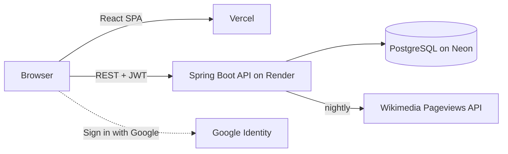

# SearchWars 🔺🔻

[](https://github.com/1Dhairyak/SearchWars/actions/workflows/ci.yml)
[](https://search-wars.vercel.app)

> **Which got more Wikipedia views last month?** Two things, one guess. One wrong answer ends your streak.


Every number is real: last month's English Wikipedia page views, refreshed automatically by the backend from the
Wikimedia Pageviews API. 100 items across 8 categories — tech, sport, music, games, anime, movies, food and memes.

## Architecture



The backend — game logic, data pipeline, migrations, auth — lives in
[1Dhairyak/searchwars-backend](https://github.com/1Dhairyak/searchwars-backend), with the full architecture and design notes.

## Frontend highlights

- **No cheating from the client.** The hidden number isn't in the page until the server has judged your guess.
- **Play first, sign up never (or later).** A random guest token identifies your device; claim a unique player name,
  or sign in with Google / email to keep your name and best score across devices.
- **Fast on cheap phones.** All animation is CSS (no animation library), images are requested at phone-friendly sizes
  and the next round's are preloaded while the answer is revealed, sounds are synthesized with the Web Audio API (no audio files).
- **Handles a sleeping backend.** The API is woken as the page loads, requests time out at 60 s with retries and
  backoff for idempotent calls, so a cold start shows a loading state instead of an error.

## Stack

React 19 · Vite 5 · Tailwind CSS 3 · React Router · native `fetch` · Google Identity Services · Vercel ·
GitHub Actions

## Local development

```bash
npm install
npm run dev          # http://localhost:5173
```

`.env.local` (not committed):

```
VITE_API_BASE_URL=http://localhost:8080/api
VITE_GOOGLE_CLIENT_ID=<your OAuth web client ID>   # optional — hides Google sign-in when unset
```

## Deploy

Vercel builds every push to `main` (`vercel.json`: SPA rewrites, immutable caching for hashed assets, security
headers). Set `VITE_API_BASE_URL` and `VITE_GOOGLE_CLIENT_ID` in Vercel's environment variables.

## Structure

```
src/
  pages/        Landing, Game, GameOver, Leaderboard, Privacy, NotFound
  components/   game/ (SideCard, VSCircle, GuessButton, ScorePopup), ui/ (Navbar, LoginModal, Logo, SoundToggle, StarfieldBg)
  hooks/        useGame — game loop against the API
  context/      GameContext — best score (synced from your account), player name, guest token, login
  services/     api, sounds, formatters, imagePreloader
```
